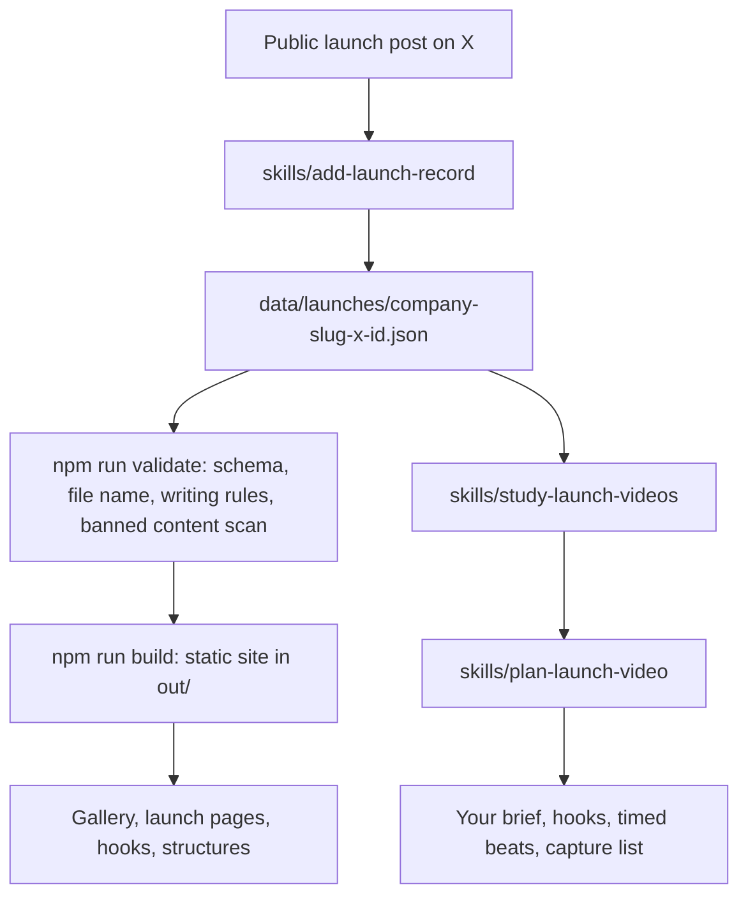

# Dreamstate launch videos

Start here: [docs/start-here.md](docs/start-here.md)

**A public library of 282 launch videos from startups, posted on X, with the company that launched each one, dated public counts, hook and structure notes, and three agent skills for planning your own launch. Built by Dreamstate.**

**[Open the live site →](#live-site)** · [Start here](docs/start-here.md) · [Data model](docs/data-model.md) · [Add a launch](docs/adding-a-launch.md) · [Skills](skills/README.md) · [Use with an agent](setup-prompt.md) · [Contributing](CONTRIBUTING.md)

## Live site

Live site: not deployed yet. The link goes here once the owner approves a deploy. Until then, run it locally (below).

## What is in it

| Part | What it holds | Where |
|---|---|---|
| Gallery | 282 launches from 267 named companies. Filter by category, hook family, views, year, and kind. Sort by views, likes, like rate, date, or company. | `app/page.tsx`, `components/Gallery.tsx` |
| Launch pages | The company, the product, who posted it, a link to the post, an X embed you load on demand, a metrics table with the read date and scope, shot rhythm where scanned, and our analysis. | `app/launches/[slug]/page.tsx` |
| Hooks | Nine hook families the openings fall into, each linked to real examples. | `app/hooks/page.tsx`, `data/hooks.json` |
| Structures | Timed beat maps for 15, 30, 60, 90, and 120 second cuts. | `app/structures/page.tsx`, `data/structures.json` |
| Data | One JSON file per launch, named after the company, checked against a schema. | `data/` |
| Skills | Plan a launch video, study the library, add a record. | `skills/` |

## How it fits together



## Quick start

```bash
npm install
npm run validate   # schema, file names, writing rules, banned content scan
npm run build      # static export to out/
npm run dev        # local preview at http://localhost:3000
```

Requires Node 20.9 or newer. CI runs validate and build on every pull request and on main. It does not deploy.

## Repo map

```text
app/                     pages: gallery, launches/[slug], hooks, structures, about
components/              Gallery, LaunchCard, NavLinks, XEmbed
lib/                     data loading and number formatting
data/
  schema.json            JSON Schema for one launch record
  launches/              one file per launch: <company-slug>-<id>.json
  hooks.json             hook families with counts
  categories.json        categories with counts
  structures.json        timed beat maps
scripts/validate-data.mjs  the validator CI runs
skills/                  three agent skills, indexed in skills/README.md
docs/                    start-here, data-model, adding-a-launch, skill-frame
setup-prompt.md          prompt to point an agent at this repo
AGENTS.md, CLAUDE.md     rules every coding agent follows here
```

## Read the numbers carefully

- Every metric is a **reported public count** read on the date shown. Most were read on 2026-10-27. Counts keep moving after that.
- Two scopes exist. **Per post** counts come from the X post itself (46 launches). **Listing** counts come from a public gallery listing read the same day (265 launches). They are separate reads, shown side by side, and never added together.
- A missing number is `null` and shows as "Not captured". Nothing is estimated.
- **Like rate** is likes divided by views. It is computed in the page and not stored.
- There is no retention, watch time, click, or signup data for any video.
- Category, kind, and hook family are **inferred from the post text**, not from watching the video. Every record says how its labels were made.
- **Company** is the business that launched, taken from the post, the listing, or the official account. It is never the poster's personal name. Four records have no company in the source, so `company` is `null` and the card says "Not named". `posted_by` always shows the account that posted.
- 16 launches have no category in the source. They show as "Not categorized" rather than a guess.
- No Dreamstate launch is in the library yet. Ours will be added with counts read by a tool, marked `owner: dreamstate`.

## What is not here

- No video files. We link to the post. Nothing is hotlinked or rehosted.
- No thumbnails. Cards are typographic until we have rights to an image.
- No transcripts and no full post text. Each record quotes 18 words at most.

## How agents use the skills

| Skill | What it does | Ask it like this |
|---|---|---|
| [`plan-launch-video`](skills/plan-launch-video/SKILL.md) | Brief, proof ledger, scored hooks, a timed script and storyboard, capture list, launch post and reply bank drafts, and audit for a launch video. | "Follow skills/plan-launch-video for our launch next week." |
| [`study-launch-videos`](skills/study-launch-videos/SKILL.md) | Finds up to five records that match a brief and returns their patterns in our own words. | "Use skills/study-launch-videos to find 60 second B2B launches with a product reveal hook." |
| [`add-launch-record`](skills/add-launch-record/SKILL.md) | Adds one launch from a public X link, or a new dated snapshot, then runs the validator. | "Add this launch with skills/add-launch-record: https://x.com/handle/status/123" |

Every skill reads [docs/skill-frame.md](docs/skill-frame.md) first. Nothing posts, sends, commits, pushes, or deploys without the owner's yes. The full prompt is in [setup-prompt.md](setup-prompt.md).

## Corrections and removals

If a record is wrong, or you own a video and want it out, open an issue. We will fix or remove it. See [CONTRIBUTING.md](CONTRIBUTING.md).

## License

Code is [MIT](LICENSE). Copyright 2026 Luis Figueroa Vale / Dreamstate. See `LICENSE` for the data note.
